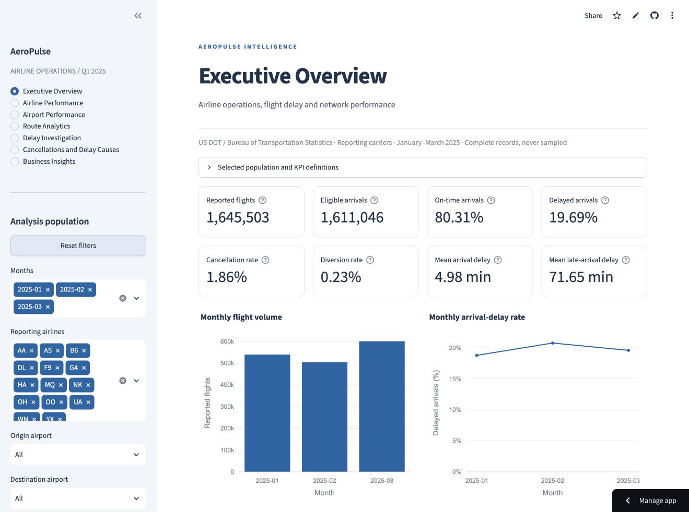
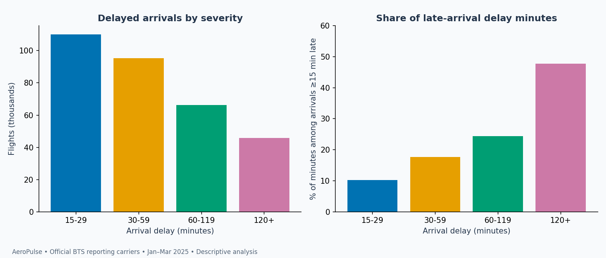
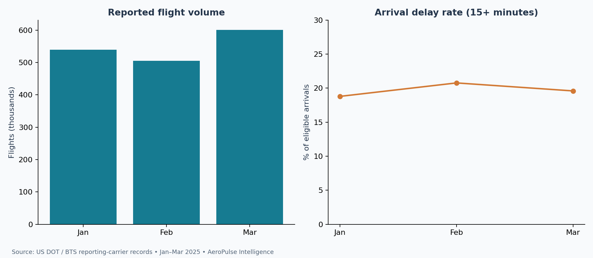

# AeroPulse Intelligence
### Airline Operations, Flight Delay & Network Performance Analytics

A reproducible **Python + DuckDB + SQL + Streamlit** analytics project for investigating airline reliability with authentic US DOT / Bureau of Transportation Statistics records. Built for Data Analyst, Business Analyst and BI Analyst portfolio review.

**Session 1 foundation:** full January–March 2025 reporting-carrier archives processed; 12 executable analyses; audited quality controls and independently reconciled KPIs. Session 3 dashboard and reporting deliverables are described below.

## Session 3 — interactive reporting

Seven Streamlit pages support executive, airline, airport, directed-route, severe-delay, cancellation/cause and business-insight analysis. Month, airline, separate airport roles, route, departure-hour and severity filters query the complete verified population. Rates are recomputed from counts; downloads include filter context. Fixed-quarter statistical studies are explicitly separate from filtered results.

```bash
python -m pip install -r requirements.txt
python -m streamlit run app.py
```

The committed 6.8 MB [deployment package](docs/DEPLOYMENT_DATA.md) contains all 1,645,503 genuine records with only required columns. No full archive download is needed on startup. **[Open the live dashboard](https://aeropulse-flight-operations-analytics.streamlit.app/)**. All seven pages and principal interactions were verified in Chrome on desktop and a 390-pixel mobile viewport. [Deployment guide](docs/DASHBOARD_DEPLOYMENT.md) · [Live QA evidence](reports/session3/LIVE_QA.json).

- [Excel business report](reports/session3/excel/AeroPulse_Airline_Operations_Business_Report.xlsx): eight sheets, seven native charts and formula-driven airline/month controls. [Validation and limitations](docs/EXCEL_REPORT.md); native Microsoft Excel opening remains unverified.
- [Power BI implementation package](docs/POWER_BI_SESSION3.md): typed Power Query imports, model relationships, DAX and layout instructions. Native Windows rendering and DAX execution remain unverified; no PBIX is claimed.
- Local regression: **189 fixture tests + 8 genuine-data integrations passed**. Logs: [fixture](reports/session3/FIXTURE_TEST_RESULTS.txt), [integration](reports/session3/INTEGRATION_TEST_RESULTS.txt). Hosted CI runs fixtures only.
- [Data reconciliation](reports/session3/DATA_PACKAGE_VALIDATION.json): 26 checks, 144 independent filtered KPI comparisons and bidirectional complete retained-record comparison.



The Streamlit product and Excel workbook are delivered. Native Power BI report creation/rendering and native Microsoft Excel open/refresh checks remain outstanding; Session 3 is not claimed fully complete across every native-BI acceptance criterion.

## Preserved Session 1 snapshot

| Measure | Result |
|---|---:|
| Source / accepted flight records | 1,645,503 / 1,645,503 |
| Quarantined / duplicate-candidate records | 0 / 0 |
| Eligible normal arrivals | 1,611,046 |
| On-time arrival rate (<15 minutes late) | 80.31% of eligible arrivals |
| Cancellation / diversion rate | 1.86% / 0.23% of all reported flights |
| SQL analyses / figures | 12 / 4 |
| Independent SQL–Python numeric comparisons | 2,749 passed |
| Local tests | 49 passed (48 fixture + 1 authentic-data integration) |

Evidence: [KPI reconciliation](reports/KPI_RECONCILIATION.json), [quality report](reports/DATA_QUALITY_REPORT.md), [test results](reports/TEST_RESULTS.txt), [analysis run](reports/ANALYSIS_RUN.json). CI runs fixture tests without downloading government data; inspect [Actions](https://github.com/harshvtomar/aeropulse-flight-operations-analytics/actions) for its current status.

## Session 2 — advanced analytics and BI preparation

Session 2 adds **10 analyses (22 total), 6 figures (10 total), day-cluster statistical intervals, transparent route/schedule mix adjustment and 14 validated BI exports**. The canonical quarter and KPI definitions remain unchanged.

- [Executive findings](reports/EXECUTIVE_BUSINESS_INSIGHTS.md): severity, delay concentration, recurring airport patterns and practical investigation priorities.
- [Extreme-delay investigation](reports/EXTREME_DELAY_INVESTIGATION.md): seven source-traced records retained; sensitivity calculations are separate from canonical KPIs.
- [Statistics](reports/STATISTICAL_ANALYSIS.md) / [methods](docs/STATISTICAL_METHODS.md): 2,000 seeded month-stratified day resamples, paired differences and explicit uncertainty limits.
- [Mix comparisons](reports/MIX_ADJUSTMENT_ANALYSIS.md): raw full-network, raw common-support and standardized rates; only 4 of 91 pairs pass overlap screens. Adjusted point estimates are not causal rankings.
- [Delay-cause reporting](reports/DELAY_CAUSE_ANALYSIS.md): all 317,266 eligible late arrivals have complete allocations, totaling 22,733,373 reported minutes; missing values are never assumed zero.
- [BI model](docs/BI_DATA_MODEL.md), [measure dictionary](docs/BI_MEASURE_DICTIONARY.md) and [DAX specifications](docs/POWER_BI_MEASURES.dax): a full Parquet fact, six dimensions and seven compact aggregate CSVs, verified with 32 checks. Data exports are regenerated locally and excluded from Git.

Independent Session 2 reconciliation passes **286,717 numeric comparisons and 21,390 labels** (SQL outputs, daily statistical inputs and mix cells). See [SQL](reports/session2/SQL_RECONCILIATION.json), [statistics](reports/session2/STATISTICAL_INPUT_RECONCILIATION.json) and [mix](reports/session2/MIX_INPUT_RECONCILIATION.json) evidence. Fixture and genuine-data test logs are separate in `reports/session2/`.



### Reproduce Session 2

After installing the pinned requirements and importing/building Session 1 as below:

```bash
python -m src.session2
python -m pytest -q -m 'not integration'
python -m pytest -q -m integration
```

The runner verifies the three raw archive fingerprints first, then executes SQL/pandas reconciliation, raw-row investigation, statistics, mix adjustment, validated BI export and figures. Individual modules can also be run independently. Run one writer at a time. A missing archive or fingerprint mismatch stops execution; do not silently accept revised files. Allow several minutes and sufficient local memory for the full quarter.

The **124 fixture tests** include 76 additional Session 2 cases; **four local integration tests** additionally passed using authentic BTS files (128 total local tests). Hosted CI intentionally runs only fixtures. These counts describe the preserved Session 2 checkpoint. The current Streamlit and Excel deliverables are documented above; native Power BI verification remains pending. See [continuation instructions](NEXT_SESSION_PROMPT.md).

## Business problem
Where are delays and cancellations concentrated across carriers, airports, routes, months and departure schedules? This foundation provides transparent denominators and sample sizes so descriptive comparisons can inform further investigation without claiming causal or financial effects.

Read the [initial business findings](reports/INITIAL_BUSINESS_FINDINGS.md). The mean eligible arrival delay is 4.98 minutes, while the mean for flights arriving at least 15 minutes late is 71.65 minutes. Preserving early arrivals and reporting the delayed-flight subset prevents a misleading single-average story.



## Architecture

Official BTS ZIP/CSV → schema and row validation → immutable monthly Parquet bundles + audit manifests → DuckDB facts/dimensions/views → versioned SQL exports → independent pandas reconciliation → Matplotlib figures and findings.

- `src/ingest.py`: official downloads, ZIP/CSV imports, monthly source hashes, atomic bundles, incremental/idempotent imports and source revision rejection.
- `src/validate.py`: hard-error quarantine, status warnings, negative delays, duplicate-candidate preservation and schema aliases.
- `src/warehouse.py` + `sql/schema.sql`: fact table, three dimensions, audit table and two reporting views.
- `sql/queries/`: 12 commented analyses with CTEs, joins, conditional aggregation and window functions.
- `src/metrics.py`: independent counts/rates/means reconciliation at network, month, airline and airport levels.
- `src/analysis.py` + `src/reporting.py`: CSV exports, four charts, measured quality report and findings.

## Install (Python 3.12+)

```bash
git clone https://github.com/harshvtomar/aeropulse-flight-operations-analytics.git
cd aeropulse-flight-operations-analytics
python3 -m venv .venv
source .venv/bin/activate
python -m pip install -r requirements.txt
```

Tested versions are pinned in `requirements.txt`; Linux Python 3.12 execution is verified. Commands are compatible with macOS, but a physical Mac installation has not been tested. Allow several GB of free disk/memory for the full-quarter import; no cloud account or paid service is needed.

## Reproduce the quarter

```bash
python -m src.ingest --download
python -m src.warehouse
python -m src.analysis
python -m pytest -q
```

The default months are January, February and March 2025. Downloads come directly from the public BTS PREZIP endpoint. If network access fails, obtain the **Reporting Carrier On-Time Performance** files from the [official selection page](https://www.transtats.bts.gov/DL_SelectFields.aspx?QO_fu146_anzr=b0-gvzr&gnoyr_VQ=FGJ). Select the entire month, all carriers and geographies, with all required fields from the [dictionary](docs/DATA_DICTIONARY.md).

```bash
python -m src.ingest --months 2025-01 --input /absolute/path/to/official-january.zip
python -m src.ingest --months 2025-02 --input /absolute/path/to/official-february.csv
python -m src.ingest --months 2025-03 --input /absolute/path/to/official-march.zip
```

Or place standard-named ZIPs in `data/raw/` and run `python -m src.ingest`. Missing files fail clearly. Exact reruns verify checksums and do not append rows. A different source file for an existing month or a changed schema fails for review. Do not silently replace imported months; preserve the old manifests and investigate revisions first. Run one writer at a time.

Raw archives, full processed/BI Parquet exports and DuckDB are excluded from Git because they are reproducible and large. The compact, complete-population dashboard Parquet is deliberately committed under deployment/data/. [Provenance](docs/DATA_PROVENANCE.md) records exact URLs, raw filenames, counts and SHA-256 fingerprints. Compare newly downloaded hashes before claiming the same source snapshot. No synthetic records are used in published analysis.

## SQL outputs

| Query | Business question |
|---|---|
| 01–02 | Overall volume/reliability and carrier comparison |
| 03–04 | Highest-volume origin and destination airport performance |
| 05 | Directed route reliability (minimum 1,000 eligible arrivals) |
| 06–08 | Monthly, weekday and scheduled local-hour patterns |
| 09 | Arrival-delay distribution |
| 10–11 | Cancellation reasons and reported delay-cause minutes |
| 12 | Within-origin carrier comparison (minimum 500 eligible arrivals) |

CSV results are in [reports/queries](reports/queries). Each query can run against `data/aeropulse.duckdb`. Read [KPI definitions](docs/KPI_DEFINITIONS.md), [grain/lineage](docs/DATA_DICTIONARY.md) and [methodology](docs/METHODOLOGY.md) before interpreting comparisons.

## Tests

```bash
python -m pytest -q -m 'not integration'  # small synthetic fixtures only
python -m pytest -q -m integration        # after full official-data pipeline
```

Fixtures are explicitly synthetic and confined to tests. The real integration test is skipped if no local database exists; CI selects fixture tests deliberately. Tests cover parsing, invalid values, source aliases, ZIP/CSV, statuses, 15-minute boundaries, early arrivals, duplicates, empty denominators, join cardinality, all SQL queries, checksums, drift, bad-file recovery, incremental imports and independent KPI reconciliation.

## Limitations and continuation

This is one quarter of domestic reporting-carrier operations, not all US aviation. Reported cause minutes are allocations, not independently proven root causes. Interactive airline/airport rankings are raw; the separate, explicitly labeled Session 2 pair-specific mix study supplies adjusted comparisons with common-support limits. Five extreme arrival delays and seven extreme departure delays are flagged but retained. There are no claimed savings or profit improvements.

Continue from [PROJECT_STATE.md](PROJECT_STATE.md), [SESSION_LOG.md](SESSION_LOG.md) and [NEXT_SESSION_PROMPT.md](NEXT_SESSION_PROMPT.md). Session 4 will complete native Excel/Power BI verification and final portfolio QA without rebuilding the established pipeline or dashboard.
